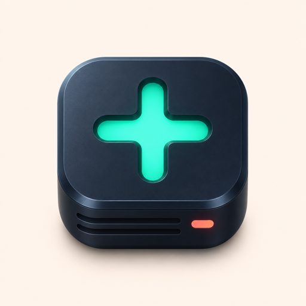
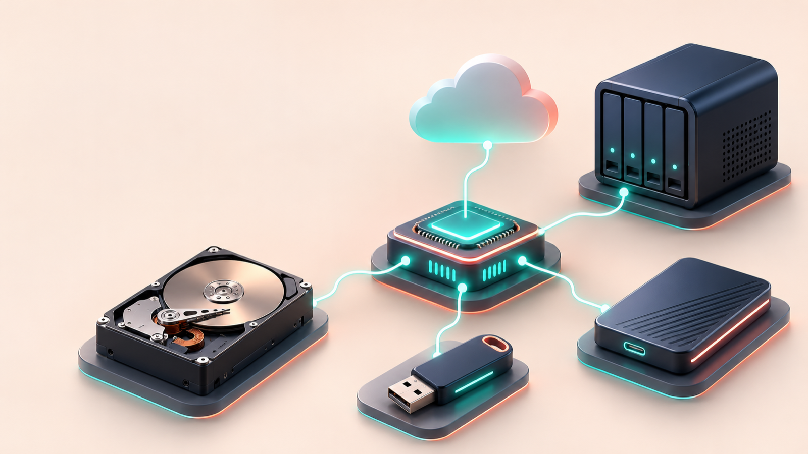

<p align="center"></p>
<h1 align="center">CachePlus</h1>
<p align="center"><strong>Use the storage you already own for the work you can rebuild.</strong></p>
<p align="center">USB · old HDD · external SSD · NAS · mounted cloud drive · internal cache volume</p>



## Your laptop should keep the work that matters

Builds, dependency caches and generated previews expand until they crowd out source files and daily work. CachePlus gives **explicitly disposable jobs** a named storage profile, a size budget, a physical free-space floor and a precise way to reclaim completed jobs. Source, Git, chats and unique files stay where they belong.

```text
mount a drive  →  configure a profile  →  run a disposable job  →  inspect  →  reclaim
```

CachePlus is local-first. It does not create accounts, format drives, upload files, move macOS swap or silently intercept every program. A remote mount can carry job data to its provider, so select it only when that is acceptable.

## Start in two minutes

Requires Python 3.10+ and macOS or Linux for job execution. Mount a writable volume you control first. CachePlus refuses an ordinary folder or missing mount.

```sh
git clone https://github.com/starkfiber/CachePlus.git
cd CachePlus
python3 -m pip install --user .
cacheplus configure /Volumes/OldSSD --name old-ssd --kind external --limit-gb 100
cacheplus status
cacheplus status --deep      # optional measured size of older completed jobs
cacheplus run --disposable my-app -- npm test
cacheplus reclaim            # preview exact completed jobs
cacheplus reclaim --yes      # apply the preview
```

For a NAS mounted at `/mnt/build-nas` or a user-mounted cloud drive at `/mnt/cloud-cache`:

```sh
cacheplus configure /mnt/build-nas --name nas --kind nas --limit-gb 80
cacheplus configure /mnt/cloud-cache --name cloud --kind cloud-mount --limit-gb 20
cacheplus backends
cacheplus use nas
```

The CLI supports `internal`, `usb`, `external`, `nas` and `cloud-mount` profile labels. Each must resolve to a writable mounted volume. Cloud account authentication and mounting are handled by the user's OS or drive client; CachePlus does **not** connect directly to Google Drive, S3, Dropbox or other account APIs in this release.

## Use with coding agents

The Codex plugin keeps the short **`/cache`** skill name. Install the marketplace with `codex plugin marketplace add starkfiber/CachePlus`, then `codex plugin add cache@cache`. Restart Codex if the skill does not appear immediately.

CachePlus includes a **local MCP server**. Its tools report free space, list profiles, assess an exact path, and run a job only when the caller supplies `disposable: true`, a safe label and an explicit command array. The run tool uses the same guarded runner as the CLI; it is **not a sandbox** and cannot force an uncooperative build tool to write inside the cache. Configure a stdio MCP client to run `cacheplus mcp`. The plugin also bundles `plugins/cache/mcp.json`. Claude, Z.ai, Antigravity and other MCP clients may use the same command if they support local MCP servers; their client-specific setup has not been tested here. MCP does not reclaim files or configure drives.

## Local API

```sh
cacheplus api --port 8767
curl http://127.0.0.1:8767/v1/status
curl http://127.0.0.1:8767/v1/backends
curl 'http://127.0.0.1:8767/v1/assess?path=/path/to/build'
```

The API binds to loopback and is read-only. A future write API needs authentication and a stronger capability model.

## What is supported

| Storage | Current support | Notes |
| --- | --- | --- |
| Internal APFS or Linux mounted volume | Yes | Use a separate volume; filesystem quotas are set outside CachePlus. |
| USB stick, old HDD, external SSD | Yes, when mounted | Prefer reliable media. A disconnected device is not a backup. |
| NAS / network filesystem | Mounted-path support | Durability and speed depend on network and mount. |
| Cloud drive | Mounted-path support | User supplies the mount and account; only disposable, authorized data should go there. |
| Native cloud account APIs | Planned | No built-in OAuth or object-store driver yet. |
| Windows job execution | Planned | The runner requires Unix locking today. |

The runner sets `TMPDIR`, `XDG_CACHE_HOME`, npm, pip, uv and Cargo target paths. Tools that ignore these variables need an explicit output argument. The limit is a **soft cap checked during execution**, not a hard disk partition or a promise that the computer can never run out of space. Set a filesystem quota separately where supported. A job can briefly overshoot between checks.

## Safety model

- Only exact CachePlus-owned completed slots are eligible for reclaim. Open handles and failed jobs stay untouched.
- Configured mounts are checked before use. If a USB or NAS path is missing, the runner refuses to write into the empty mountpoint.
- Source, Git, chats, histories, credentials, app state and sole copies are persistent data.
- The assessor is a conservative review aid, not permission to purge a folder.
- One drive, including a cloud sync folder, is not an independent backup.

## Contribute

CachePlus is [MIT licensed](LICENSE). Contributions are welcome for filesystem quotas, Windows support, mount health checks, native cloud adapters, richer MCP client guides and measured performance. Run `python3 -m unittest discover -s tests -v` before a pull request. Keep provider credentials and personal data out of issues and test fixtures.

Current release: **0.4.0 MVP**. The mounted-volume runner, CLI, MCP and local API have bounded local tests. Linux CI and real USB/NAS/cloud provider runs still need independent confirmation. See the [measured benchmark and WhatIF results](docs/BENCHMARKS.md).

See the [product page](docs/index.html).
